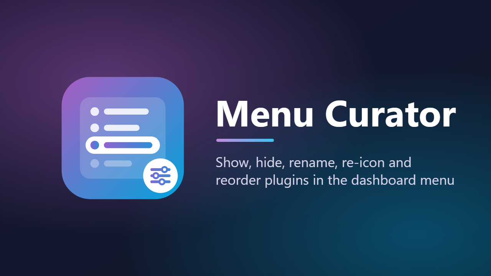

<p align="center">
  
</p>

<p align="center">
  <a href="https://github.com/barryanderson/jellyfin-menu-curator/actions/workflows/ci.yaml"></a>
  <a href="https://github.com/barryanderson/jellyfin-menu-curator/releases/latest"></a>
  
  <a href="LICENSE"></a>
</p>

# Menu Curator

**Take control of the Plugins section of the Jellyfin dashboard menu.**

Many plugins add an entry to the dashboard menu, and many useful settings pages are not in the menu at all. Menu Curator lets administrators decide what appears there, what it is called, which icon it shows and where it sits.

## Contents

- [Features](#features)
- [Requirements](#requirements)
- [Installation](#installation)
- [Using Menu Curator](#using-menu-curator)
- [How it works](#how-it-works)
- [Frequently asked questions](#frequently-asked-questions)
- [Uninstalling and rolling back](#uninstalling-and-rolling-back)
  - [Getting the normal menu back](#getting-the-normal-menu-back)
- [Troubleshooting](#troubleshooting)
- [Contributing](#contributing)
- [Licence](#licence)

## Features

- **Hide** plugin pages you never use, without disabling the plugin. Their settings stay available from **Dashboard > Plugins**.
- **Add** pages that their plugins leave out of the menu, so the settings you use most are one click away.
- **Rename** any entry.
- **Change icons** from a list of suitable icons. The plugin's own icon is offered first when it has one, and any other Material icon can be entered by name.
- **Reorder** entries with move up and move down buttons.
- **Instant updates:** saving reloads the dashboard with the new menu.
- **Safe by design:** the menu is adjusted on the server, with no scripts injected into the web client. If anything goes wrong, the normal menu is served and a warning is logged.
- **Keeps your rules** for plugins that are disabled or removed, and applies them again if the plugin returns.
- **Reset in one click** from the settings page, or from a scheduled task if the settings page cannot be opened.

## Requirements

- Jellyfin **12.2 or later**.
- An administrator account.

Works on any Jellyfin installation: the official Docker image, the linuxserver.io image, native Linux packages and Windows.

## Installation

### From the plugin repository (recommended)

1. In Jellyfin, open **Dashboard > Plugins** and select **Manage Repositories**. Add a repository:

   | Field | Value |
   |---|---|
   | Name | `Menu Curator` |
   | URL | `https://raw.githubusercontent.com/barryanderson/jellyfin-menu-curator/main/manifest.json` |

2. Back on **Dashboard > Plugins**, show **Available** plugins or search for "Menu Curator", open it and select **Install**.
3. Restart Jellyfin when prompted.

New versions then appear on the Plugins page like any other plugin update.

### Manual installation

1. Download `menu-curator_<version>.zip` from the [latest release](https://github.com/barryanderson/jellyfin-menu-curator/releases/latest).
2. Find Jellyfin's data folder: on the dashboard home page, the **Paths** card lists it as **Program Data**. The server log also prints it at startup.
3. Inside its `plugins` folder, create a folder called `MenuCurator_<version>` (for example `MenuCurator_1.0.0.0`) and extract the zip into it. The folder should contain `Jellyfin.Plugin.MenuCurator.dll`, `meta.json` and `banner.png`.
4. Make sure the account Jellyfin runs as can read the folder, then restart Jellyfin.

Typical plugin folders, as examples:

| Installation | Plugins folder |
|---|---|
| Official Docker image | `/config/plugins` |
| linuxserver.io Docker image | `/config/data/plugins` |
| Debian and Ubuntu packages | `/var/lib/jellyfin/plugins` |
| Windows | `%ProgramData%\Jellyfin\Server\plugins` |

For Docker, these paths are inside the container: copy the files to wherever your `/config` volume is on the host.

## Using Menu Curator

Open **Menu Curator** from the dashboard menu, or from **Dashboard > Plugins > Menu Curator > Settings**.

| Section | What you can do |
|---|---|
| **In the menu** | The pages currently in the menu, in order. Untick a page to hide it, set a **Menu name**, choose an **Icon**, and use the arrows to move it. |
| **Other pages** | Pages that are not in the menu. Tick one to add it to the bottom of the menu. |
| **Rules for pages that are not loaded** | Rules for plugins that are disabled or removed. Untick one to delete it. Shown only when needed. |
| **Plugins with no settings page** | Plugins that have no page, so cannot appear in the menu. |
| **Reset** | **Reset menu** deletes all your Menu Curator settings and returns the menu to normal. |

Click **Save**. The dashboard reloads with the new menu.

The [user guide](docs/user-guide.md) explains every option in detail.

## How it works

The dashboard builds its Plugins menu by asking the server for the list of plugin configuration pages that belong in the menu. Menu Curator adjusts that one list on the server, just before it is sent, by applying the rules you save:

1. **Hide** the pages you have unticked.
2. **Add** the pages you have ticked from **Other pages**.
3. **Override** names and icons.
4. **Order** the entries, with any new pages placed after the ones you have ordered.

Nothing else is changed. In particular, the full page list that the Plugins pages use for their **Settings** links is left exactly as the server built it. Your rules are stored with the plugin's configuration, in `plugins/configurations/Jellyfin.Plugin.MenuCurator.xml`.

The research behind this approach, with references to the Jellyfin source, is in [docs/findings.md](docs/findings.md).

## Frequently asked questions

**Can I use a plugin's logo as its menu icon?**
No. The dashboard menu draws icons from the Material icon font by name, so only Material icons can be shown. When a plugin declares an icon of its own, Menu Curator offers it first.

**Does each administrator get their own menu?**
No. The menu is the same for every administrator, on every device.

**Why is a plugin missing from the list?**
Only plugins that register a settings page can appear in the menu. Plugins without one are listed at the bottom of the settings page. Disabled plugins do not appear until they are enabled again.

**Can I group entries into sections?**
Not at the moment. Jellyfin 12.2 places every plugin entry in a single Plugins section, and ignores the section a plugin asks for.

**What happens when a plugin is updated?**
Your rules keep applying, as long as the plugin keeps the same page names. If a plugin adds a new menu page, it appears at the bottom of the menu until you place it.

**Can Menu Curator break my dashboard?**
It is designed not to. It only changes the menu list, and if anything unexpected happens it serves the normal menu instead. Resetting or uninstalling it restores the normal menu straight away, and disabling it does so at the next dashboard reload.

## Uninstalling and rolling back

- **Reset the menu, keeping the plugin:** select **Reset menu** on the Menu Curator settings page, or run **Reset dashboard menu** from **Dashboard > Scheduled Tasks**.
- **Uninstall:** open **Dashboard > Plugins**, select **Menu Curator** and choose **Uninstall**. The menu returns to normal straight away; restart Jellyfin when prompted to finish removing the plugin. Disabling the plugin also returns the menu to normal; reload the dashboard to see it, as the dashboard can keep the old menu for up to a minute.
- **Remove manually:** stop Jellyfin, delete the `MenuCurator_<version>` folder from the plugins folder, and start Jellyfin.
- **Roll back:** remove the current version, then install an earlier release's zip manually.
- **Forget your rules:** delete `plugins/configurations/Jellyfin.Plugin.MenuCurator.xml`.

### Getting the normal menu back

| Situation | What to do |
|---|---|
| The settings page works | Select **Reset menu** at the bottom of the settings page. |
| The settings page does not open | Run **Reset dashboard menu** from **Dashboard > Scheduled Tasks**, or [reset from the command line](#reset-from-the-command-line). |
| You deleted the plugin folder by hand | [Restart Jellyfin](#after-deleting-the-plugin-folder), then reload the dashboard. |
| The dashboard still shows the old menu | Wait a minute and reload, or [clear the dashboard's cached menu](#clear-the-dashboards-cached-menu). |

#### Reset from the command line

These commands use Jellyfin's API, so they work without the settings page. They need an API key: create one under **Dashboard > API Keys**, and keep it private. Replace `http://your-server:8096` with your server's address, including any base URL path, and `YOUR_API_KEY` with the key.

Delete every Menu Curator rule, keeping the plugin installed:

```bash
curl -X POST "http://your-server:8096/Plugins/c86ff527-927b-4653-abc1-4b7d6fbf1a09/Configuration" \
  -H "Authorization: MediaBrowser Token=\"YOUR_API_KEY\"" \
  -H "Content-Type: application/json" \
  -d '{"Entries":[]}'
```

Or uninstall the plugin, then restart Jellyfin when convenient:

```bash
curl -X DELETE "http://your-server:8096/Plugins/c86ff527-927b-4653-abc1-4b7d6fbf1a09" \
  -H "Authorization: MediaBrowser Token=\"YOUR_API_KEY\""
```

Both print nothing when they succeed. An HTTP 404 from the first command means Menu Curator is not loaded, so it is not changing the menu.

On Windows PowerShell, the reset is:

```powershell
Invoke-RestMethod -Method Post `
  -Uri "http://your-server:8096/Plugins/c86ff527-927b-4653-abc1-4b7d6fbf1a09/Configuration" `
  -Headers @{ Authorization = 'MediaBrowser Token="YOUR_API_KEY"' } `
  -ContentType "application/json" -Body '{"Entries":[]}'
```

#### After deleting the plugin folder

Jellyfin keeps running plugins loaded until it restarts, so deleting the folder has no effect until then. Restart Jellyfin, for example:

| Installation | Restart |
|---|---|
| Docker | `docker restart <container name>` |
| Linux packages | `sudo systemctl restart jellyfin` |
| Windows | Restart Jellyfin from its tray icon, or restart the Jellyfin service in **Services** |

Once Jellyfin has restarted without the plugin, it sends the normal menu. Reload the dashboard. The leftover settings file, `plugins/configurations/Jellyfin.Plugin.MenuCurator.xml`, has no effect without the plugin; delete it if you want a clean slate when reinstalling.

#### Clear the dashboard's cached menu

The dashboard keeps a copy of the menu in the browser for up to a minute, and keeps it across reloads. To drop that copy straight away, open the dashboard, press F12, open the **Console** tab, paste this and press Enter:

```js
(r => { r.onupgradeneeded = () => r.transaction.abort(); r.onerror = () => location.reload(); r.onsuccess = () => { const db = r.result; try { const tx = db.transaction('keyval', 'readwrite'); tx.objectStore('keyval').delete('jellyfin-query-cache'); tx.oncomplete = () => location.reload(); } catch { location.reload(); } }; })(indexedDB.open('keyval-store'));
```

It deletes only the dashboard's cached data (your sign-in is kept) and reloads the page. Each browser keeps its own copy, so run it in each browser that still shows the old menu.

## Troubleshooting

| Problem | What to try |
|---|---|
| The menu has not changed after saving | Reload the dashboard. If it still shows the old menu, wait a minute and reload again, or [clear the dashboard's cached menu](#clear-the-dashboards-cached-menu). |
| I hid Menu Curator and cannot find it | Open **Dashboard > Plugins**, select **Menu Curator**, then **Settings**. |
| I want the normal menu back | See [Getting the normal menu back](#getting-the-normal-menu-back), which also covers a manually deleted plugin folder. |
| The settings page shows an error | Look in the browser console for lines starting with `[MenuCurator]`, and in the server log for lines containing `MenuCurator`. |
| No plugin image on the Plugins page | Check that `banner.png` and `meta.json` are in the plugin folder, and restart Jellyfin. |

If you need help, please [open an issue](https://github.com/barryanderson/jellyfin-menu-curator/issues) with your Jellyfin version, how Jellyfin is installed, and any `MenuCurator` lines from the server log and browser console. Remove access tokens and other private details first.

## Contributing

Bug reports, ideas and pull requests are welcome.

### Building from source

Requires the [.NET 10 SDK](https://dotnet.microsoft.com/download).

```bash
dotnet build -c Release
dotnet test
```

The plugin is built to `Jellyfin.Plugin.MenuCurator/bin/Release/net10.0/Jellyfin.Plugin.MenuCurator.dll`. Test changes on a throwaway server first: [dev/README.md](dev/README.md) sets one up with Docker.

### Project layout

| Path | Contents |
|---|---|
| `Jellyfin.Plugin.MenuCurator/` | The plugin: the menu filter, the rule engine, the page list endpoint and the settings page. |
| `Jellyfin.Plugin.MenuCurator.Tests/` | Unit tests. |
| `build.yaml` | Plugin metadata and the version number, used when packaging releases. |
| `manifest.json` | The plugin repository that Jellyfin servers read. Updated automatically on release. |
| `assets/` | Logo and banner, as SVG sources and PNG renders. |
| `dev/` | A Docker Compose setup for a throwaway test server. |
| `docs/` | The user guide, release process and research notes. |

Releases are built by GitHub Actions from version tags; see [docs/releasing.md](docs/releasing.md). Changes are listed in [CHANGELOG.md](CHANGELOG.md).

## Licence

Menu Curator is licensed under the [GNU General Public Licence v3.0](LICENSE), like the [Jellyfin plugin template](https://github.com/jellyfin/jellyfin-plugin-template) it is based on.

Menu Curator is a community plugin and is not affiliated with the Jellyfin project.
